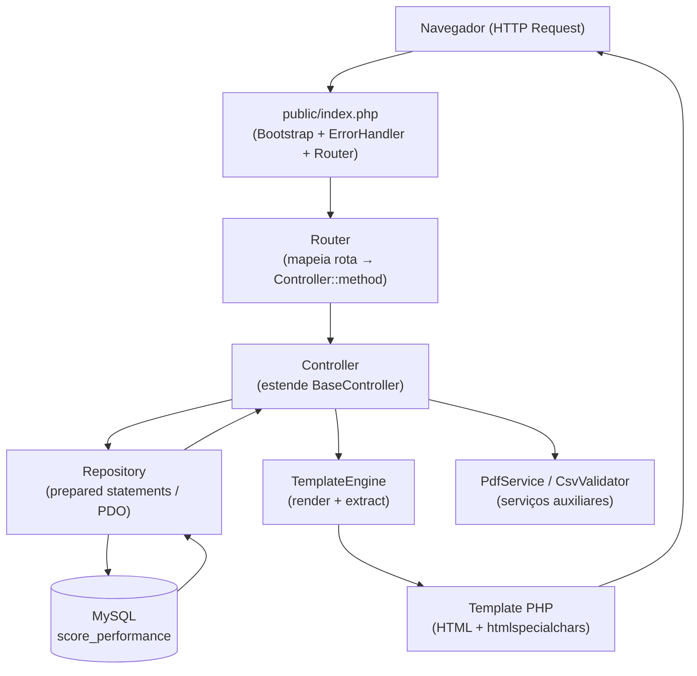

# Design Document

## Overview

Este documento descreve a arquitetura técnica da reestruturação do projeto **ScorePerformanceWeb** para PHP 8.2, introduzindo namespaces PSR-4, autoloading automático, separação real de responsabilidades (MVC limpo), injeção de dependência, configuração via variáveis de ambiente e proteção contra SQL injection. O comportamento funcional existente é preservado integralmente.

---

## Architecture

### Diagrama de Camadas



### Fluxo de Requisição Típico

1. `public/index.php` carrega o autoloader, inicializa `DotenvLoader`, registra o handler global de exceções e chama `Router::dispatch()`.
2. O `Router` lê `$_SERVER['REQUEST_URI']` e `$_SERVER['REQUEST_METHOD']`, localiza a entrada na tabela de rotas e instancia o Controller correspondente.
3. O Controller recebe suas dependências (Repository, TemplateEngine) via construtor e executa o método de ação.
4. O método de ação chama o Repository, processa os dados e passa um array para `$this->render($template, $data)`.
5. O `TemplateEngine` faz `extract($data, EXTR_SKIP)` em escopo isolado e inclui o arquivo de template.
6. O template renderiza HTML usando `htmlspecialchars()` em todos os dados variáveis.

---

## Components and Interfaces

### 1. Autoloader (PSR-4)

**Arquivo:** `autoload.php` (raiz do projeto)

Registra via `spl_autoload_register` o mapeamento do namespace raiz `ScorePerformance\\` para o diretório `src/`. Converte separadores de namespace em separadores de diretório e anexa `.php`.

```php
// Assinatura simplificada
spl_autoload_register(function (string $class): void {
    $prefix = 'ScorePerformance\\';
    $baseDir = __DIR__ . '/src/';
    if (!str_starts_with($class, $prefix)) { return; }
    $file = $baseDir . str_replace('\\', '/', substr($class, strlen($prefix))) . '.php';
    if (!file_exists($file)) {
        throw new \ScorePerformance\Exceptions\ClassNotFoundException($class);
    }
    require $file;
});
```

### 2. DotenvLoader

**Namespace:** `ScorePerformance\Config`
**Arquivo:** `src/Config/DotenvLoader.php`

Carrega variáveis do arquivo `.env` da raiz do projeto. Cada linha no formato `KEY=VALUE` é registrada via `putenv()` e `$_ENV`. Linhas iniciadas com `#` são ignoradas.

```php
final class DotenvLoader
{
    /**
     * @param  string[] $required  Chaves obrigatórias
     * @throws ConfigurationException se .env não existir ou chave obrigatória estiver ausente
     */
    public static function load(string $envPath, array $required = []): void;
}
```

### 3. DatabaseConnection (Singleton)

**Namespace:** `ScorePerformance\Database`
**Arquivo:** `src/Database/DatabaseConnection.php`

Singleton que lê credenciais via `getenv()` após `DotenvLoader::load()`. Configura PDO com `ERRMODE_EXCEPTION`, `FETCH_ASSOC` e `EMULATE_PREPARES => false`. Garante uma única conexão PDO por processo PHP.

```php
final class DatabaseConnection
{
    private static ?self $instance = null;
    private readonly \PDO $pdo;

    private function __construct();
    private function __clone(): void;

    public static function getInstance(): self;
    public function getPdo(): \PDO;
}
```

**Variáveis de ambiente lidas:**
| Variável | Descrição |
|---|---|
| `DB_HOST` | Host do MySQL |
| `DB_NAME` | Nome do banco |
| `DB_USER` | Usuário |
| `DB_PASS` | Senha |

### 4. Router

**Namespace:** `ScorePerformance\Router`
**Arquivo:** `src/Router/Router.php`

Tabela de rotas mapeando `[METHOD, path]` para `[ControllerClass, method]`. Resolve parâmetros de query string via `$_GET`/`$_POST`.

```php
final class Router
{
    public function add(string $method, string $path, string $controller, string $action): void;
    public function dispatch(): void;
}
```

**Tabela de rotas:**

| Método | Caminho | Controller | Método |
|---|---|---|---|
| GET | `/` | HomeController | index |
| GET | `/regras` | RegrasController | index |
| GET | `/faixas-detalhadas` | FaixasDetalhadasController | index |
| GET | `/faixas-organizadas` | FaixasOrganizadasController | index |
| GET, POST | `/lancar-valores` | ScorePerformanceController | lancamento |
| GET, POST | `/valores-processados` | ScorePerformanceController | index |
| GET, POST | `/report-journey` | ScorePerformanceController | reportJourney |
| GET, POST | `/report-team` | ScorePerformanceController | reportTeam |
| POST | `/load-csv` | LoadDataTemplateController | upload |
| GET | `/print-pdf` | PrintPdfController | print |

### 5. BaseController (Abstract)

**Namespace:** `ScorePerformance\Controllers`
**Arquivo:** `src/Controllers/BaseController.php`

Classe abstrata que todos os Controllers concretos estendem. Fornece métodos protegidos para renderização e tratamento de erro.

```php
abstract class BaseController
{
    public function __construct(
        private readonly TemplateEngine $templateEngine
    );

    protected function render(string $template, array $data = []): void;
    protected function handleError(string $message, string $template = 'error'): void;
    protected function redirect(string $url): never;
}
```

### 6. TemplateEngine

**Namespace:** `ScorePerformance\Views`
**Arquivo:** `src/Views/TemplateEngine.php`

Renderiza templates PHP em escopo isolado usando `extract()`. Garante que variáveis de uma renderização não vazem para outra.

```php
final class TemplateEngine
{
    public function __construct(private readonly string $templateDir);

    /**
     * @param  string               $template  Nome do template (sem extensão)
     * @param  array<string, mixed> $data      Variáveis expostas ao template
     * @throws \RuntimeException se o arquivo de template não existir
     */
    public function render(string $template, array $data = []): void;
}
```

Implementação interna usa closure para isolar escopo:

```php
$render = static function (string $file, array $vars): void {
    extract($vars, EXTR_SKIP);
    require $file;
};
$render($templatePath, $data);
```

### 7. Controllers

Todos os Controllers são `final`, estendem `BaseController` e recebem suas dependências via construtor (injeção de dependência).

#### ScorePerformanceController

**Arquivo:** `src/Controllers/ScorePerformanceController.php`

```php
final class ScorePerformanceController extends BaseController
{
    public function __construct(
        TemplateEngine $templateEngine,
        private readonly ScorePerformanceRepository $repository
    );

    public function index(): void;       // lista todos os scores processados
    public function lancamento(): void;  // formulário de lançamento unitário
    public function reportJourney(): void;
    public function reportTeam(): void;
}
```

#### RegrasController

```php
final class RegrasController extends BaseController
{
    public function __construct(TemplateEngine $templateEngine, private readonly RegrasRepository $repository);
    public function index(): void;
}
```

#### FaixasDetalhadasController

```php
final class FaixasDetalhadasController extends BaseController
{
    public function __construct(TemplateEngine $templateEngine, private readonly FaixasDetalhadasRepository $repository);
    public function index(): void;
}
```

#### FaixasOrganizadasController

```php
final class FaixasOrganizadasController extends BaseController
{
    public function __construct(TemplateEngine $templateEngine, private readonly FaixasOrganizadasRepository $repository);
    public function index(): void;
}
```

#### LoadDataTemplateController

Usa **composição** com `ScorePerformanceRepository` (sem herança). Processa CSV linha a linha.

```php
final class LoadDataTemplateController extends BaseController
{
    public function __construct(
        TemplateEngine $templateEngine,
        private readonly ScorePerformanceRepository $repository,
        private readonly CsvValidator $validator
    );

    public function upload(): void;  // POST /load-csv
}
```

#### PrintPdfController

```php
final class PrintPdfController extends BaseController
{
    public function __construct(
        TemplateEngine $templateEngine,
        private readonly PdfService $pdfService
    );

    public function print(): void;  // GET /print-pdf?PDF=Regras|FaixaDet|FaixaOrg|scorePerformance
}
```

### 8. Repositories

Cada Repository substitui o Model correspondente. Recebe PDO via `DatabaseConnection::getInstance()`. Todos os métodos que recebem entrada do usuário usam prepared statements. Lança `RepositoryException` em caso de falha PDO; retorna `[]` quando nenhum resultado é encontrado.

#### ScorePerformanceRepository

```php
final class ScorePerformanceRepository
{
    public function __construct(private readonly \PDO $pdo);

    /** @return array<int, array<string, mixed>> */
    public function findAll(): array;

    /** @return array<int, array<string, mixed>> */
    public function findByFilters(array $filters): array;

    /** @return array<int, array<string, mixed>> */
    public function findJourneys(): array;

    /** @return array<int, array<string, mixed>> */
    public function findSquads(): array;

    /** @return array<int, array<string, mixed>> */
    public function findMetrics(): array;

    /** @return array<int, array<string, mixed>> */
    public function findCategories(): array;

    /**
     * Grava via stored procedure CALL ScorePerformance(...) com bindParam.
     * @throws RepositoryException
     */
    public function save(array $params): string;

    // Métodos privados por tipo de query (7 variações com filtros diferentes)
    private function fetchScoreByAll(...): array;
    private function fetchScoreByJourneyAndTeam(...): array;
    private function fetchScoreByJourneyTeamPeriod(...): array;
    private function fetchScoreByJourneyTeamSprint(...): array;
    private function fetchRankingByJourneySprint(...): array;
    private function fetchRankingByJourneyPeriod(...): array;
    private function fetchRankingByJourney(...): array;
}
```

#### RegrasRepository

```php
final class RegrasRepository
{
    public function __construct(private readonly \PDO $pdo);
    /** @return array<int, array<string, mixed>> */
    public function findAll(): array;
}
```

#### FaixasDetalhadasRepository

```php
final class FaixasDetalhadasRepository
{
    public function __construct(private readonly \PDO $pdo);
    /** @return array<int, array<string, mixed>> */
    public function findAll(): array;
    /** @return array<int, array<string, mixed>> */
    public function findIdeal(): array;  // somente "Atendeu Totalmente"
}
```

#### FaixasOrganizadasRepository

```php
final class FaixasOrganizadasRepository
{
    public function __construct(private readonly \PDO $pdo);
    /** @return array<int, array<string, mixed>> */
    public function findAll(): array;
}
```

### 9. CsvValidator

**Namespace:** `ScorePerformance\Validators`
**Arquivo:** `src/Validators/CsvValidator.php`

Valida cabeçalho e conteúdo do CSV. Usa `filter_var()` com `FILTER_VALIDATE_INT` / `FILTER_VALIDATE_FLOAT`. Retorna array de erros por linha; array vazio indica CSV válido.

```php
final class CsvValidator
{
    /** Colunas esperadas no CSV */
    private const EXPECTED_COLUMNS = ['ID_JORNADA','ID_TIME','ID_CATEGORIA','ID_METRICA','PERIODO','SPRINT','VALOR'];

    /**
     * @return array<int, array{line: int, message: string}>  Erros encontrados
     */
    public function validate(string $filePath): array;

    private function validateRow(array $row, int $lineNumber): array;
}
```

### 10. PdfService

**Namespace:** `ScorePerformance\Services`
**Arquivo:** `src/Services/PdfService.php`

Encapsula `PDF extends TCPDF` e `PdfTableBuilder`. O Controller não conhece detalhes de TCPDF.

```php
final class PdfService
{
    /**
     * Gera e envia o PDF diretamente para o browser.
     *
     * @param  string               $templateName  'Regras' | 'FaixaDet' | 'FaixaOrg' | 'scorePerformance'
     * @param  array<string, mixed> $data          Dados do relatório
     * @throws PdfServiceException
     */
    public function generate(string $templateName, array $data): void;
}
```

Internamente mantém a classe `PDF extends TCPDF` (cabeçalho/rodapé) e `PdfTableBuilder` (tabela paginada com 15 linhas por página) já implementadas na refatoração anterior.

### 11. ErrorHandler

**Arquivo:** `public/index.php` (registrado no bootstrap)

```php
set_exception_handler(static function (\Throwable $e): void {
    error_log($e->getMessage() . "\n" . $e->getTraceAsString());
    if (getenv('APP_ENV') === 'development') {
        echo '<pre>' . htmlspecialchars((string)$e, ENT_QUOTES | ENT_HTML5) . '</pre>';
    } else {
        http_response_code(500);
        echo 'Ocorreu um erro interno. Por favor, tente novamente.';
    }
});
```

---

## Data Models

### Diagrama de Classes

```mermaid
classDiagram
    direction TB

    class BaseController {
        <<abstract>>
        -TemplateEngine templateEngine
        +__construct(TemplateEngine)
        #render(string, array) void
        #handleError(string, string) void
        #redirect(string) never
    }

    class ScorePerformanceController {
        -ScorePerformanceRepository repository
        +index() void
        +lancamento() void
        +reportJourney() void
        +reportTeam() void
    }

    class RegrasController {
        -RegrasRepository repository
        +index() void
    }

    class FaixasDetalhadasController {
        -FaixasDetalhadasRepository repository
        +index() void
    }

    class FaixasOrganizadasController {
        -FaixasOrganizadasRepository repository
        +index() void
    }

    class LoadDataTemplateController {
        -ScorePerformanceRepository repository
        -CsvValidator validator
        +upload() void
    }

    class PrintPdfController {
        -PdfService pdfService
        +print() void
    }

    BaseController <|-- ScorePerformanceController
    BaseController <|-- RegrasController
    BaseController <|-- FaixasDetalhadasController
    BaseController <|-- FaixasOrganizadasController
    BaseController <|-- LoadDataTemplateController
    BaseController <|-- PrintPdfController

    ScorePerformanceController --> ScorePerformanceRepository
    RegrasController --> RegrasRepository
    FaixasDetalhadasController --> FaixasDetalhadasRepository
    FaixasOrganizadasController --> FaixasOrganizadasRepository
    LoadDataTemplateController --> ScorePerformanceRepository
    LoadDataTemplateController --> CsvValidator
    PrintPdfController --> PdfService

    class DatabaseConnection {
        <<Singleton>>
        -static self instance
        -PDO pdo
        -__construct()
        +static getInstance() self
        +getPdo() PDO
    }

    class ScorePerformanceRepository {
        -PDO pdo
        +findAll() array
        +findByFilters(array) array
        +findJourneys() array
        +findSquads() array
        +findMetrics() array
        +findCategories() array
        +save(array) string
    }

    class RegrasRepository {
        -PDO pdo
        +findAll() array
    }

    class FaixasDetalhadasRepository {
        -PDO pdo
        +findAll() array
        +findIdeal() array
    }

    class FaixasOrganizadasRepository {
        -PDO pdo
        +findAll() array
    }

    DatabaseConnection --> ScorePerformanceRepository : provides PDO
    DatabaseConnection --> RegrasRepository : provides PDO
    DatabaseConnection --> FaixasDetalhadasRepository : provides PDO
    DatabaseConnection --> FaixasOrganizadasRepository : provides PDO

    class DotenvLoader {
        <<static>>
        +static load(string, array) void
    }

    class TemplateEngine {
        -string templateDir
        +render(string, array) void
    }

    class CsvValidator {
        +validate(string) array
    }

    class PdfService {
        +generate(string, array) void
    }

    class Router {
        +add(string, string, string, string) void
        +dispatch() void
    }
```



### Mapeamento de Classes (Legado → Novo)

| Classe legada | Nova classe | Namespace |
|---|---|---|
| `DatabaseConnection` | `DatabaseConnection` | `ScorePerformance\Database` |
| `controllerScorePerformance` | `ScorePerformanceController` | `ScorePerformance\Controllers` |
| `controllerLoadDataTemplate` | `LoadDataTemplateController` | `ScorePerformance\Controllers` |
| `controllerRegras` | `RegrasController` | `ScorePerformance\Controllers` |
| `controllerFaixasDetalhadas` | `FaixasDetalhadasController` | `ScorePerformance\Controllers` |
| `controllerFaixasOrganizadas` | `FaixasOrganizadasController` | `ScorePerformance\Controllers` |
| `PDF` + `PdfTableBuilder` | `PdfService` | `ScorePerformance\Services` |
| `modelScorePerformance` | `ScorePerformanceRepository` | `ScorePerformance\Models` |
| `modelRegras` | `RegrasRepository` | `ScorePerformance\Models` |
| `modelFaixasDetalhadas` | `FaixasDetalhadasRepository` | `ScorePerformance\Models` |
| `modelFaixasOrganizadas` | `FaixasOrganizadasRepository` | `ScorePerformance\Models` |
| `Redirect` | `Redirect` | `ScorePerformance\Config` |
| `SanitizeTransaction` | `SanitizeTransaction` | `ScorePerformance\Config` |
| _(novo)_ | `DotenvLoader` | `ScorePerformance\Config` |
| _(novo)_ | `Router` | `ScorePerformance\Router` |
| _(novo)_ | `TemplateEngine` | `ScorePerformance\Views` |
| _(novo)_ | `BaseController` | `ScorePerformance\Controllers` |
| _(novo)_ | `CsvValidator` | `ScorePerformance\Validators` |

---

## Error Handling

### Hierarquia de Exceções

```
\Throwable
└── \Exception
    ├── ScorePerformance\Exceptions\ClassNotFoundException
    ├── ScorePerformance\Exceptions\ConfigurationException
    ├── ScorePerformance\Exceptions\DatabaseConnectionException
    ├── ScorePerformance\Exceptions\RepositoryException
    └── ScorePerformance\Exceptions\PdfServiceException
\RuntimeException
    └── \InvalidArgumentException  (usada por Controllers para parâmetro ausente)
```

### Estratégia por Camada

| Camada | Tratamento |
|---|---|
| Autoloader | Lança `ClassNotFoundException` se arquivo não encontrado |
| DotenvLoader | Lança `ConfigurationException` listando variáveis ausentes |
| DatabaseConnection | Lança `DatabaseConnectionException`; registra em `error_log` |
| Repository | Captura `\PDOException`; lança `RepositoryException`; retorna `[]` em resultado vazio |
| Controller | Captura exceções de domínio; chama `handleError()` sem expor stack trace |
| Handler global | `set_exception_handler` em `public/index.php`; detalha só em `APP_ENV=development` |

---

## Correctness Properties

### Propriedades de Corretude (Property-Based Testing)

As propriedades abaixo devem ser verificáveis por testes automatizados:

### Property 1: Singleton DatabaseConnection
> Para quaisquer duas chamadas `DatabaseConnection::getInstance()` no mesmo processo PHP, o objeto retornado é identicamente o mesmo (`===`).<br>
Forma: `∀ (c1, c2) ∈ getInstance × getInstance : c1() === c2()`<br>

### Property 2: Autoloader PSR-4
> Para qualquer classe `ScorePerformance\X\Y`, o autoloader resolve o caminho como `src/X/Y.php`.<br>
Forma: `∀ class ∈ ScorePerformance\*: autoload(class) → src/ + class.replace('\\','/') + '.php'`<br>

### Property 3: Repository retorna array
> Para qualquer método `find*()` de qualquer Repository, o retorno é sempre `array` (possivelmente vazio), nunca `null`.<br>
Forma: `∀ repo, ∀ method ∈ find*: is_array(repo.method()) === true`<br>

### Property 4: Batch Load integridade do relatório
> O total de linhas de um relatório de lote é sempre igual à soma de sucesso e falha.<br>
Forma: `∀ csv: report.total === report.success + report.failure`<br>

### Property 5: TemplateEngine sem vazamento de escopo
> Uma segunda chamada a `render()` não tem acesso a variáveis da primeira chamada.<br>
Forma: `∀ (d1, d2) com chaves disjuntas: vars(d1) ∩ scope(render(d2)) = ∅`<br>

### Property 6: CsvValidator rejeita cabeçalho inválido
> Para qualquer CSV cujo cabeçalho difira de `EXPECTED_COLUMNS`, `validate()` retorna ao menos um erro.<br>
Forma: `∀ csv: header ≠ EXPECTED_COLUMNS → count(validate(csv)) > 0`<br>

---

## Testing Strategy

### Propriedades de Corretude (Property-Based Testing)

As propriedades abaixo devem ser verificáveis por testes automatizados:

### Property 1: Singleton DatabaseConnection
> Para quaisquer duas chamadas `DatabaseConnection::getInstance()` no mesmo processo PHP, o objeto retornado é identicamente o mesmo (`===`).

```
∀ (call1, call2) ∈ getInstance × getInstance:
    call1() === call2()
```

### Property 2: Autoloader PSR-4
> Para qualquer classe `ScorePerformance\X\Y`, o autoloader resolve o caminho como `src/X/Y.php` e nunca como outro caminho.

```
∀ className ∈ ScorePerformance\*:
    autoload(className) resolves to src/ + className.replace('\\', '/') + '.php'
```

### Property 3: Repository retorna array (nunca null)
> Para qualquer método `find*()` de qualquer Repository, o retorno é sempre um `array` (possivelmente vazio `[]`), nunca `null`.

```
∀ repo ∈ Repositories, ∀ method ∈ find*:
    is_array(repo.method()) === true
```

#### P4 — Batch Load: soma de resultados
> O total de linhas processadas em um lote CSV é sempre igual à soma das linhas com sucesso mais as linhas com falha.

```
∀ csvFile: BatchReport.total === BatchReport.success + BatchReport.failure
```

#### P5 — TemplateEngine não vaza variáveis
> Uma segunda chamada a `TemplateEngine::render()` com template diferente não tem acesso a variáveis passadas na primeira chamada.

```
∀ (render1_data, render2_data) com chaves disjuntas:
    variáveis de render1 NÃO estão disponíveis no escopo de render2
```

### Property 6: CsvValidator rejeita cabeçalho inválido
> Para qualquer CSV cujo cabeçalho difira de `EXPECTED_COLUMNS`, `CsvValidator::validate()` retorna ao menos um erro.

```
∀ csv com header ≠ EXPECTED_COLUMNS:
    count(validator.validate(csv)) > 0
```

---

## Directory Structure

```
ScorePerformanceWeb/
├── public/
│   ├── index.php               ← bootstrap: autoload + dotenv + handler + router
│   └── assets/
│       ├── templates.css
│       ├── ScorePerformance.pdf
│       └── templateScorePerformance/
├── src/
│   ├── Config/
│   │   ├── AppConfig.php
│   │   ├── DotenvLoader.php
│   │   ├── Redirect.php
│   │   └── SanitizeTransaction.php
│   ├── Database/
│   │   └── DatabaseConnection.php
│   ├── Controllers/
│   │   ├── BaseController.php
│   │   ├── ScorePerformanceController.php
│   │   ├── RegrasController.php
│   │   ├── FaixasDetalhadasController.php
│   │   ├── FaixasOrganizadasController.php
│   │   ├── LoadDataTemplateController.php
│   │   └── PrintPdfController.php
│   ├── Models/
│   │   ├── ScorePerformanceRepository.php
│   │   ├── RegrasRepository.php
│   │   ├── FaixasDetalhadasRepository.php
│   │   └── FaixasOrganizadasRepository.php
│   ├── Services/
│   │   └── PdfService.php
│   ├── Validators/
│   │   └── CsvValidator.php
│   ├── Exceptions/
│   │   ├── ClassNotFoundException.php
│   │   ├── ConfigurationException.php
│   │   ├── DatabaseConnectionException.php
│   │   ├── RepositoryException.php
│   │   └── PdfServiceException.php
│   ├── Router/
│   │   └── Router.php
│   └── Views/
│       ├── TemplateEngine.php
│       └── templates/
│           ├── partials/
│           │   ├── navbar.php
│           │   ├── footer.php
│           │   └── performance_bands.php
│           ├── home.php
│           ├── regras.php
│           ├── faixasDetalhadas.php
│           ├── faixasOrganizadas.php
│           ├── lancarValores.php
│           ├── scorePerformance.php
│           ├── reportJourney.php
│           └── reportTeam.php
├── autoload.php
├── .env
├── .env.example
└── .gitignore
```

### Arquivo `.env.example`

```
APP_ENV=development
DB_HOST=localhost
DB_NAME=score_performance
DB_USER=root
DB_PASS=
```

---

## Migration Strategy

Para migrar sem quebrar o sistema em produção, a estratégia é **incremental por módulo**:

1. **Fase 1 — Infraestrutura**: Criar `autoload.php`, `DotenvLoader`, `DatabaseConnection` com namespace, `TemplateEngine`, `BaseController`, `Router`. Manter os arquivos legados funcionando em paralelo via `include_once` transitório.

2. **Fase 2 — Repositories**: Migrar um Repository por vez, substituindo os Models. Os Controllers legados continuam funcionando porque a interface pública dos métodos é preservada.

3. **Fase 3 — Controllers**: Migrar Controllers para namespaced, estendendo `BaseController`. Atualizar as entradas de rota no `Router`.

4. **Fase 4 — Views/Templates**: Mover templates para `src/Views/templates/`. Atualizar paths no `TemplateEngine`.

5. **Fase 5 — Serviços**: Criar `PdfService` e `CsvValidator`. Remover classes legadas `PDF` e `PdfTableBuilder` de `controllerScorePerformancePrintPDF.php`.

6. **Fase 6 — Ponto de entrada**: Criar `public/index.php` como entry point único. Atualizar `.htaccess` ou configuração do Apache para apontar para `public/`.

7. **Fase 7 — Limpeza**: Remover arquivos legados (`system/controller*.php`, `system/model*.php`, `system/view*.php`). Remover métodos `@deprecated`.